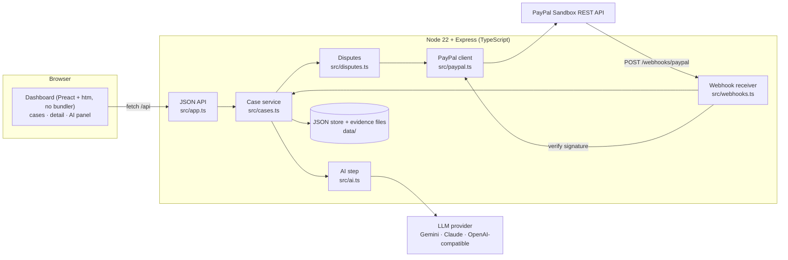

# Dispute Defender

**Evidence-first PayPal dispute defence for small sellers and freelancers.** When a buyer opens a dispute,
Dispute Defender pulls the case from PayPal, checks the seller's evidence, uses AI to judge how strong the
case is, lists the proof that is missing, tracks the deadline and drafts a response.
**The seller reviews and approves everything. The AI never sends anything on its own.**

Built for the [PayPal AI Hackathon](https://paypalaihackathon.devpost.com/). Sandbox only.

- Live demo: _add the Render URL here after deploying_
- Demo video: _add the YouTube URL here_

---

## The problem

Small sellers lose PayPal disputes they should win.

- **Evidence gets lost or is never used.** Sellers report losing disputes "that we had complete documentation
  about" ([PayPal Community thread](https://www.paypal-community.com/t5/Security-and-Fraud/Help-We-lost-a-dispute-that-we-had-complete-documentation-about/td-p/3176871)),
  and UK Financial Ombudsman decisions (for example DRN-3721889) have found that relevant evidence was not
  considered.
- **Sellers don't know what proof counts** for each dispute type, and they miss deadlines. PayPal's
  [disputes documentation](https://developer.paypal.com/disputes/overview) gives buyer and seller up to 20 days
  to resolve an inquiry before it can escalate to a claim, which PayPal then decides.
- **Funds are held while a case is open**, which hurts most for a one-person business.

A large merchant has a chargeback team. A freelancer has an inbox and a deadline they did not know about.

## Who it is for

Small online sellers and freelancers who take payments through PayPal and handle disputes themselves.

## What it does

| Feature | What you get |
| --- | --- |
| **Case intake** | Add a dispute by its PayPal ID, re-sync it any time, or receive it by webhook (`CUSTOMER.DISPUTE.CREATED / UPDATED / RESOLVED`) with PayPal signature verification. |
| **Urgency dashboard** | Tracked cases sorted by soonest seller deadline, with reason, amount, stage and a countdown. |
| **Case detail** | Reason, amount, stage and state, buyer and seller, transaction IDs, message thread, PayPal's evidence trail, refund amounts, and the actions PayPal allows right now. |
| **Deadline tracking** | Uses PayPal's `seller_response_due_date` when present. Otherwise estimates the 20-day inquiry window and labels it clearly as an estimate. |
| **Evidence locker** | Per case: delivery proof, tracking, chat transcripts, invoices or contracts, other. Notes plus optional TXT, MD, CSV, PNG, JPG, WEBP, GIF or PDF upload (validated, 2 MB limit). |
| **AI analysis** | A 0-100 strength score with reasoning, what PayPal needs for this dispute type, a prioritised list of missing evidence, a recommended action (refund, contest, ask the buyer, escalate) with trade-offs, the assumptions the model made, and a draft response. Output is schema-validated and retried once if invalid. |
| **Human approval** | The draft is editable. **Approve & send** asks for confirmation, then calls the matching PayPal action. **Copy response** is always available. |
| **Honest results** | Success is shown only when PayPal returns 2xx. A refusal shows PayPal's exact error code, a plain-English explanation, the debug ID, and a "Copy response + open Resolution Center" fallback. |
| **Audit log** | Every sync, analysis, edit, copy, send attempt and webhook delivery is recorded per case and in a global activity feed. |

## Architecture



More detail: [docs/architecture.md](docs/architecture.md).

## PayPal APIs used

| API | Call | Where | Purpose |
| --- | --- | --- | --- |
| OAuth 2.0 | `POST /v1/oauth2/token` | `src/paypal.ts` | Client-credentials token, cached until expiry |
| Disputes | `GET /v1/customer/disputes/{id}` | `src/disputes.ts` | Case intake and sync (also after every webhook and send) |
| Disputes | `POST /v1/customer/disputes/{id}/send-message` | `src/disputes.ts` | Message the buyer |
| Disputes | `POST /v1/customer/disputes/{id}/provide-evidence` | `src/disputes.ts` | Submit evidence (multipart) |
| Disputes | `POST /v1/customer/disputes/{id}/make-offer` | `src/disputes.ts` | Offer a refund |
| Disputes | `POST /v1/customer/disputes/{id}/escalate` | `src/disputes.ts` | Escalate to a claim |
| Disputes | `POST /v1/customer/disputes/{id}/accept-claim` | `src/disputes.ts` | Accept the claim (refund) |
| Webhooks | `POST /v1/notifications/verify-webhook-signature` | `src/webhooks.ts` | Verify each incoming dispute event |
| Orders v2 | `POST /v2/checkout/orders`, `.../capture` | `scripts/` | Create and capture a sandbox payment so a dispute can be reproduced |

The actions the app offers come from the HATEOAS `links` PayPal returns on the dispute, so the UI shows which
actions PayPal has open for the case at that moment.

## AI: which tools and how

**In the product.** One reasoning step, `POST /api/cases/:id/analyze`, behind a provider-agnostic interface
(`generateJson(system, user, schema)` in [`src/ai.ts`](src/ai.ts)). The adapter is picked by `AI_PROVIDER`:

| Provider | Default model | Status |
| --- | --- | --- |
| `gemini` (Google AI Studio) | `gemini-2.5-flash`, fallback `gemini-flash-lite-latest` | **Used for the demo and all real runs** |
| `anthropic` | `claude-sonnet-5-5` | Implemented, not exercised with a live key |
| `openai-compatible` (Groq, OpenRouter, ...) | set `AI_MODEL` | Implemented, not exercised with a live key |

How the model is used:

- **Input:** the normalised dispute (buyer and seller emails and account IDs are stripped) plus the evidence
  locker. Text files are passed as text, images as image parts, PDFs by file name and note only.
- **Output:** JSON validated with [zod](https://zod.dev). Invalid output is retried once with the validation
  errors; a second failure is reported to the user as a failure.
- **Truthfulness:** the system prompt forbids inventing facts, requires missing proof to be flagged, and
  requires assumptions to be listed.
- **Prompt-injection safety:** dispute messages and uploaded evidence are user-written, so they are fenced as
  data and the system prompt tells the model never to follow instructions found inside them.
- **Human in the loop:** the model only drafts. Nothing reaches PayPal without the seller clicking approve and
  confirming. The UI shows the analysis time and the model that produced it.

**To build it.** The codebase, tests and docs were written with **Claude Code** (Anthropic's coding agent)
from a written build brief, with the owner directing and reviewing.

## Run it locally

Requirements: Node.js 22+, a PayPal **sandbox** app (US business account), and one AI key.

```bash
git clone https://github.com/VigneshwaranKbgv/dispute-defender.git
cd dispute-defender
npm install
cp .env.example .env    # then fill in the values
npm run dev
```

Open <http://localhost:3000>.

Minimum `.env`:

```ini
PAYPAL_CLIENT_ID=your-sandbox-client-id
PAYPAL_CLIENT_SECRET=your-sandbox-client-secret
PAYPAL_BASE_URL=https://api-m.sandbox.paypal.com
AI_PROVIDER=gemini
GEMINI_API_KEY=your-key        # free tier from https://aistudio.google.com/apikey
```

All variables are described in [`.env.example`](.env.example). The app refuses to start if
`PAYPAL_BASE_URL` is not a sandbox URL.

| Command | What it does |
| --- | --- |
| `npm run dev` | Start with reload on <http://localhost:3000> |
| `npm run build` then `npm start` | Compile to `dist/` and run |
| `npm test` | Unit tests (Vitest) |
| `npm run typecheck` / `npm run lint` | TypeScript and ESLint |

### Try it in two minutes

1. Click **Add the demo case** (or paste a dispute ID from your own sandbox account).
2. In the evidence locker, click **Add sample evidence** (fictional files from
   [`docs/sample-evidence/`](docs/sample-evidence/)), or upload your own.
3. Click **Analyze case**. Read the score, the missing evidence and the draft.
4. Edit the draft, choose how to send it, click **Approve & send**, confirm, and see what PayPal answers.

The demo case `PP-R-BYM-10198930` belongs to the project's sandbox seller account, so it only loads with that
account's credentials (as on the hosted demo). With your own sandbox app, create your own dispute:

### Reproduce a sandbox dispute

Disputes cannot be created through the API (see Known limitations), so the buyer opens one by hand.

1. `npm run sandbox:create-order` creates a USD 10.00 order and prints an approval link.
2. Open the link in a private window, log in as the **US sandbox buyer**, and pay.
3. `npm run sandbox:capture-order -- <ORDER_ID>` captures the payment.
4. As the buyer, go to <https://www.sandbox.paypal.com/resolutioncenter/>, choose **Report a problem**, pick the
   payment and report **"I didn't receive my item"**.
5. Copy the case ID (`PP-R-...`) into **Add a case**, or let the webhook deliver it.

Sandbox accounts must be **US** accounts. Other regions failed checkout in our testing.

### Sandbox test credentials for judges

Sandbox only. These accounts hold no real money.

| Account | Email | Password |
| --- | --- | --- |
| Sandbox buyer (personal, US) | _owner to fill in_ | _owner to fill in_ |

The hosted demo already has the sandbox seller credentials configured, so judges only need the buyer login to
open a new dispute, and the demo password if one is set: _owner to fill in_.

## Deploy to Render

The repo includes [`render.yaml`](render.yaml) (one free web service, health check at `/healthz`).

1. In Render: **New > Blueprint**, pick this repo.
2. Enter the secret values when asked: `PAYPAL_CLIENT_ID`, `PAYPAL_CLIENT_SECRET`, `GEMINI_API_KEY`, and
   optionally `APP_PASSWORD` (shared password for the demo) and `PAYPAL_WEBHOOK_ID`.
3. After the first deploy, register `https://<service>.onrender.com/webhooks/paypal` in the PayPal developer
   dashboard (your sandbox app > Webhooks) for **Customer dispute created**, **updated** and **resolved**.
   Copy the webhook ID into `PAYPAL_WEBHOOK_ID` and redeploy.

Render's free tier has an ephemeral disk, so tracked cases reset on each deploy or restart. The app handles an
empty store and offers a one-click **Add the demo case**.

## Security

- PayPal and AI keys live only in server environment variables and are never sent to the browser or logged.
- Sandbox guard: the server will not start against a non-sandbox PayPal URL.
- Dispute text and uploads are untrusted. The UI renders them as text only (no HTML injection), a strict
  Content-Security-Policy is set, and uploaded files are served sandboxed with `nosniff`.
- Uploads are limited to an allowlist of types, 2 MB each, with content checked against the declared type,
  stored under server-generated names.
- Webhooks are accepted only after PayPal verifies the signature, and the case is then re-fetched from PayPal
  rather than trusted from the webhook body.
- Optional shared password (`APP_PASSWORD`) with an HttpOnly, SameSite cookie and login rate limiting.
- The AI step treats case data and evidence as data, not instructions (see above).

## Known limitations (from real testing)

Everything below was observed against the PayPal sandbox on 11 Nov 2026 unless marked otherwise.

- **Creating a dispute through the API does not work for this app.** `POST /v1/customer/disputes` failed
  ("No permissions to set target_client_id" / `INVALID_BUYER_TRANSACTION_ID`). The buyer opens disputes in
  the sandbox Resolution Center.
- **The list endpoint returned nothing.** `GET /v1/customer/disputes` returned 0 items while a case existed,
  so the app never polls a list. Cases are tracked by ID, from manual entry or webhooks.
- **Sending a message worked.** `send-message` returned **HTTP 200** while the case was
  `WAITING_FOR_SELLER_RESPONSE`, and the message appeared in the PayPal thread. An earlier attempt, while the
  same case was `UNDER_PAYPAL_REVIEW`, was refused with 422 `ACTION_NOT_ALLOWED_IN_CURRENT_DISPUTE_STATE`.
- **Submitting evidence worked when PayPal had asked for it.** `provide-evidence` with the requested type
  (`PROOF_OF_FULFILLMENT`) and a note returned **HTTP 200**, and PayPal then listed the evidence as
  `SUBMITTED_BY_SELLER`. An attempt with type `OTHER`, made while the case was under review, was refused with
  400 `EVIDENCE_TYPE_IS_NOT_ALLOWED`; the app showed that error and the fallback as designed.
- **File attachments to PayPal are not yet verified.** The successful evidence submission carried a note and
  no files. Attaching images or PDFs is implemented but has not been confirmed against the sandbox. PayPal
  does not accept text files as attachments; those stay in the locker and inform the AI draft.
- **`make-offer`, `escalate` and `accept-claim` are implemented but not exercised.** They are irreversible on
  a case, and there was one demo case. They use the same error handling and audit trail.
- **Sandbox case state changes on its own for a few minutes after an action** (for example
  `WAITING_FOR_SELLER_RESPONSE` to `UNDER_REVIEW` to `WAITING_FOR_BUYER_RESPONSE`), and the allowed actions
  change with it. Press **Sync** to refresh.
- **Webhooks have not been tested end to end yet.** They need a public URL. The receiver, signature
  verification and upsert are covered by unit tests with mocked HTTP. Others have reported dispute webhooks
  not firing in the sandbox. If they do not arrive, add cases by ID. _Update this line after the deploy test._
- **Deadlines can be estimates.** When PayPal omits `seller_response_due_date`, the date shown is the opening
  date plus 20 days for inquiries, labelled "Estimate". No date is invented for other stages.
- **AI limits.** Only the Gemini adapter has been run live. The `gemini-flash-latest` alias did not answer
  within 60 seconds in testing, so the default is `gemini-2.5-flash` with a fallback model; free-tier models
  can still return 503 when busy. PDFs are not read by the AI (name and note only), and at most 4 images are
  sent. The model can be wrong, which is why a person approves every response.
- **Single seller, simple storage.** One PayPal account, a JSON file store, and an optional shared password.
  No user accounts. The store resets on Render's free tier.

## Tech stack

Node.js 22, TypeScript, Express 5, zod, Preact + htm (served as static ES modules, no bundler), Vitest,
ESLint. Storage is a JSON file with atomic writes. Hosting: Render.

## Project layout

```
src/         server: paypal, disputes, deadline, evidence, ai, cases, webhooks, store, app, server
public/      dashboard: index.html, app.js, lib.js, styles.css
test/        unit tests
scripts/     sandbox helpers (create and capture an order, read a dispute)
docs/        architecture, Devpost copy, video script, sample evidence
```

## License

[MIT](LICENSE)
