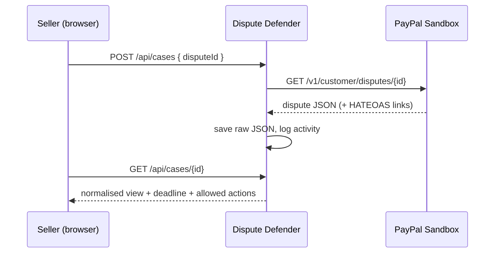
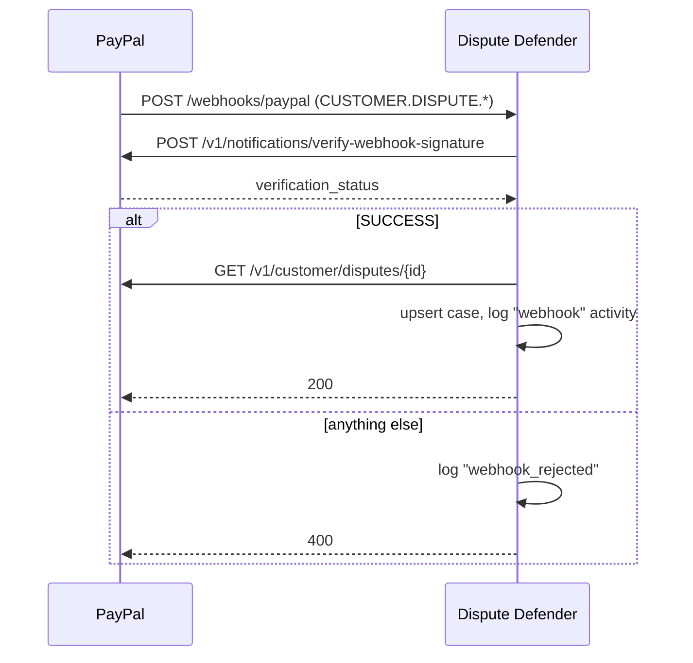
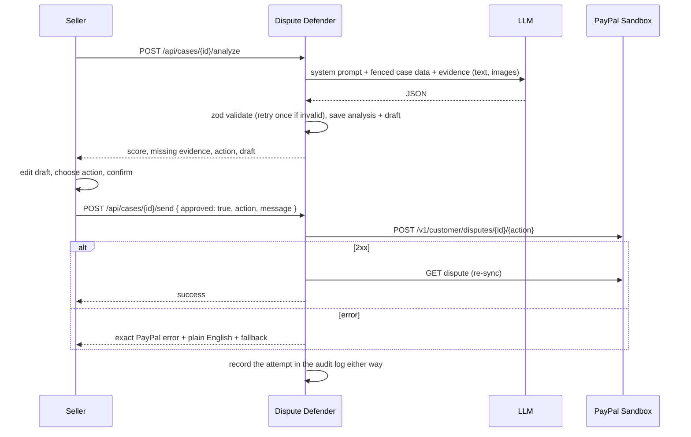

# Architecture

Dispute Defender is one Node.js process: an Express server that exposes a JSON API, receives PayPal webhooks
and serves a static single-page dashboard. There is no build step for the front end and no database server.

## Components

| Module | Responsibility |
| --- | --- |
| `src/paypal.ts` | Sandbox guard, OAuth client-credentials token cached until expiry, one `api()` helper. Timeouts on every call. Retries only transient failures: GET on 429/5xx, other methods on 429 only, so a message or evidence submission is never sent twice. |
| `src/disputes.ts` | `fetchDispute`, `normalizeDispute` (raw PayPal JSON to a stable view model, tolerant of missing fields), the five seller actions, and `explainPayPalError` (exact PayPal codes plus plain English). |
| `src/deadline.ts` | Seller deadline: PayPal's date when supplied, otherwise a labelled 20-day estimate for inquiries. Urgency levels and the sort order for the dashboard. |
| `src/evidence.ts` | Evidence locker files: type allowlist, size limit, content sniffing, server-generated file names. Loads content for the AI step and attachments for PayPal. |
| `src/ai.ts` | `generateJson(system, user, schema)` with Gemini, Anthropic and OpenAI-compatible adapters, a fallback-model wrapper, the analysis schema (zod), the system prompt and the prompt builder. |
| `src/cases.ts` | The case service used by every route: add or sync, evidence, analysis, draft, send, audit entries. |
| `src/webhooks.ts` | Verifies the PayPal signature, then re-fetches the case by ID and upserts it. |
| `src/store.ts` | JSON file repository (`data/db.json`): in-memory cache, serialized writes, write-to-temp then rename. |
| `src/app.ts` | Express wiring: security headers, optional password gate, routes, error mapping, static files. |
| `public/` | Preact + htm dashboard loaded as ES modules. Two columns: case list on the left, case detail on the right as stacked cards (details, messages, evidence, case review, suggested response, history). One column on phones. |

## Main flows

### Add or sync a case



The raw PayPal JSON is stored and normalised on read, so improving the normaliser never needs a migration.

### Webhook intake



The raw request body is embedded byte-for-byte in the verification call, because re-serialising the JSON can
break signature checks. Case data is never taken from the webhook body.

### Analyse, approve, send



The send endpoint rejects any request without `approved: true`, and nothing else in the server calls a seller
action, so there is no path for the AI to send on its own.

## Data model (`data/db.json`)

```ts
{
  cases: {
    [disputeId]: {
      id, dispute /* raw PayPal JSON */, addedAt, syncedAt,
      source: 'manual' | 'webhook' | 'demo',
      evidence: [{ id, type, note, addedAt, file?: { name, mimeType, size, storedAs } }],
      analysis?: { result, provider, model, at, attempts },
      draft?: string
    }
  },
  activity: [{ id, at, caseId | null, type, summary, detail? }]   // newest first, capped at 1000
}
```

Evidence files live in `data/evidence/<disputeId>/<uuid>.<ext>`.

## Design decisions

- **Track by ID, never by list.** The disputes list endpoint returned no items in sandbox testing, so intake is
  by ID (manual or webhook).
- **Let PayPal say what is allowed.** Allowed actions come from the dispute's `links`. The UI marks other
  actions "not open now" but still lets the seller try, and shows any refusal.
- **Provider-agnostic AI.** One small interface, three adapters, so the app runs on a free Gemini key or a
  Claude key without code changes.
- **No bundler, no CDN.** The dashboard is plain ES modules; Preact + htm is served from `node_modules`. This
  keeps the Content-Security-Policy strict (`script-src 'self'`).
- **JSON file store.** Enough for a single-seller demo, no native dependencies, atomic writes. Swap
  `src/store.ts` for a database to go further.
